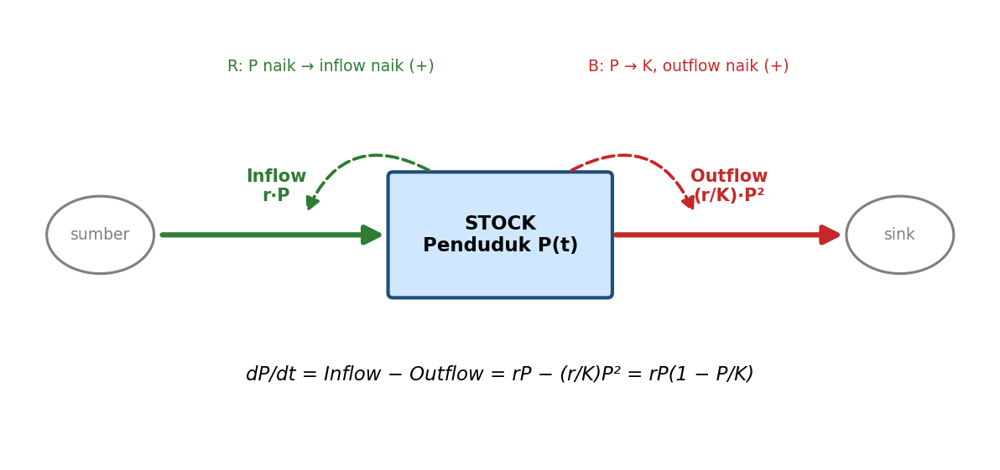
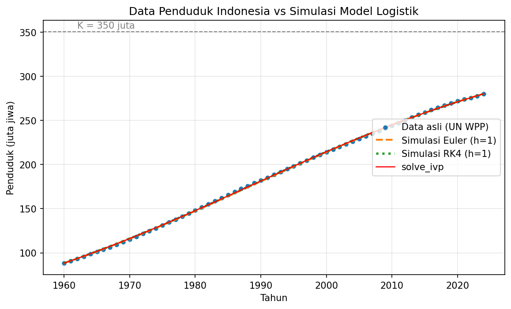
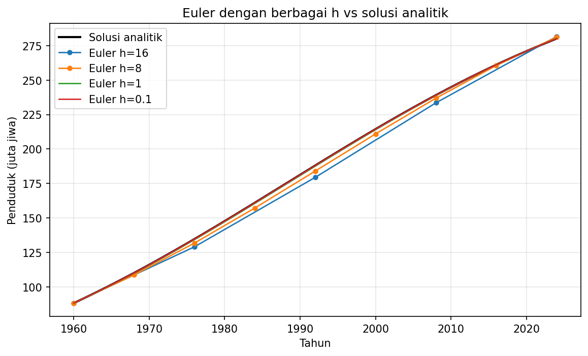
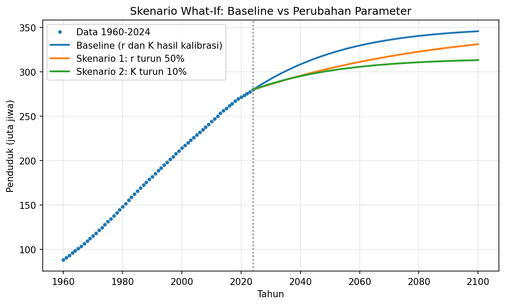

# Simulasi Sistem Dinamik: Pertumbuhan Penduduk Indonesia (Model Logistik)

Tugas Akhir 07 (TA-07), Praktikum **Pemodelan dan Simulasi**, Modul 7: *Dynamic System Simulation*.

**Nama:** Fahriansyah Putra | **NIM:** 301240024 | **Kelas:** 5-B

## Ringkasan

Proyek ini memodelkan jumlah penduduk Indonesia tahun 1960–2024 dengan **model pertumbuhan logistik**

```
dP/dt = r · P · (1 − P/K)
```

dengan P = jumlah penduduk (juta jiwa), r = laju pertumbuhan intrinsik, dan K = kapasitas dukung. Model disimulasikan dengan tiga metode (Euler, Runge–Kutta 4, dan `scipy.integrate.solve_ivp`), parameter r dan K dikalibrasi dari data, lalu dilakukan eksperimen skenario *What-If*.

## Struktur Model (Stock–Flow)

| Elemen | Pada model ini |
|---|---|
| Stock | Jumlah penduduk P(t) |
| Inflow | Pertumbuhan alami r·P (loop *reinforcing*) |
| Outflow | Hambatan lingkungan (r/K)·P² (loop *balancing*) |



## Dataset

- **File:** `indonesia_population.csv` (kolom `Year`, `Population` dalam jiwa; 65 baris, 1960–2024, tanpa nilai hilang)
- **Sumber:** United Nations, *World Population Prospects* (data tahunan penduduk Indonesia), diakses melalui Macrotrends: https://www.macrotrends.net/countries/IDN/indonesia/population
- Data adalah data riil, bukan data buatan (dummy).

## Hasil

Parameter hasil kalibrasi (*least squares*, `scipy.optimize.curve_fit`): **r = 0.03856 per tahun (3.86%/tahun)** dan **K = 350.38 juta jiwa**, dengan P0 = 88.38 juta jiwa (data 1960).

| Metode | RMSE (juta jiwa) | MAPE (%) |
|---|---|---|
| Euler (h = 1) | 0.8255 | 0.3929 |
| RK4 (h = 1) | 0.7518 | 0.3720 |
| `solve_ivp` | 0.7518 | 0.3720 |



**Pengaruh langkah waktu h pada Euler** (galat maksimum terhadap solusi analitik): h = 16 → 8.60 juta; h = 8 → 4.05 juta; h = 1 → 0.480 juta; h = 0,1 → 0.048 juta.



**Skenario What-If (proyeksi 2024 → 2100):**

| Skenario | Penduduk 2050 (juta) | Penduduk 2100 (juta) |
|---|---|---|
| Baseline | 320.7 | 345.7 |
| r turun 50% | 303.9 | 331.1 |
| K turun 10% | 301.3 | 313.2 |

r menentukan **seberapa cepat** penduduk menuju batas, sedangkan K menentukan **di mana** penduduk berhenti.



> Proyeksi 2024–2100 adalah konsekuensi dari model dengan r dan K konstan, bukan prakiraan resmi. Nilai K hasil ekstrapolasi dan tidak pasti karena data masih jauh dari titik jenuh.

## Struktur Repositori

```
.
├── TA07_Dynamic_System_Simulation.ipynb   # notebook utama (model, kalibrasi, simulasi, What-If)
├── TA07_Dynamic_System_Simulation.py      # versi skrip dari notebook
├── indonesia_population.csv               # dataset
├── app.py                                 # aplikasi web Streamlit
├── requirements.txt
├── figures/                               # gambar hasil simulasi
└── Laporan/                               # laporan TP-09 dan TA-07 (docx dan pdf)
```

## Cara Menjalankan

```bash
# 1. Clone repositori
git clone <URL-REPOSITORI-ANDA>
cd <NAMA-FOLDER>

# 2. (Opsional) buat virtual environment
python -m venv venv
source venv/bin/activate        # Windows: venv\Scripts\activate

# 3. Pasang dependensi
pip install -r requirements.txt

# 4a. Jalankan notebook
jupyter notebook TA07_Dynamic_System_Simulation.ipynb
#     (atau unggah notebook dan CSV ke Google Colab)

# 4b. Jalankan aplikasi web
streamlit run app.py
```

Pastikan `indonesia_population.csv` berada satu folder dengan notebook dan `app.py`.

## Tautan

- **Video demo:** <tempel-link-YouTube>
- **Aplikasi (deployment):** <tempel-link-aplikasi>

## Referensi

- Fikri, R. (2023). *Exploratory Data Analysis (EDA)*. Medium. https://medium.com/leaptelkom/exploratory-data-analysis-eda-659eb379f360
- Islam, N. (n.d.). *Comprehensive Guide to Time Series Data Analytics and Forecasting with Python*. Medium.
- United Nations, DESA, Population Division. *World Population Prospects*.
- The SciPy Community. *scipy.integrate.solve_ivp*. https://docs.scipy.org/doc/scipy/reference/generated/scipy.integrate.solve_ivp.html
- Strogatz, S. H. (2015). *Nonlinear Dynamics and Chaos* (2nd ed.). Westview Press.
